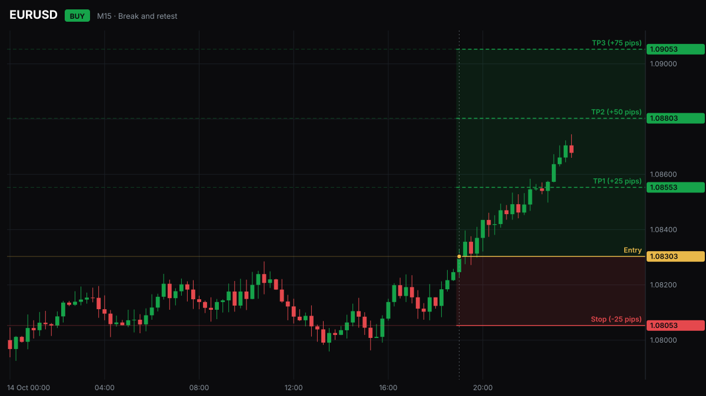

# signal-chart

Draw a trade signal: candles with the entry, the stop loss and the take profit targets, shaded risk and reward, and a price tag for every level. As **SVG** (pure JavaScript, no dependencies, Node and browsers), as **PNG** (in Node, with the optional `@resvg/resvg-js`), or as price lines and zones on a **lightweight charts** chart you already have.



<sub>The candles in the examples are a seeded random walk, not market data.</sub>

```sh
npm install trading-signal-chart
```

## SVG

```js
import { renderSvg } from 'trading-signal-chart';

const svg = renderSvg({
  candles,                      // [[time, open, high, low, close], ...] or [{ time, open, high, low, close }]
  signal: {
    pair: 'EURUSD',
    side: 'buy',                // 'buy' | 'sell' (or 'long' | 'short')
    entry: 1.08303,
    stop: 1.08053,
    targets: [1.08553, 1.08803, 1.09053],
    time: 1792094400,           // the signal's candle: the marker and the zones start here (default: the last candle)
  },
}, { timeframe: 'M15', title: 'Break and retest' });
```

Times are Unix seconds, `Date`s or ISO strings, and are shown in UTC. The output is the same for the same input, so it can be cached or snapshot-tested.

Options: `width` (1200), `height` (675), `theme` (`'dark'`, `'light'`, or colours to override, e.g. `{ entry: '#5B8DEF' }`), `decimals`, `pip`, `timeframe`, `title`, `rightSpace` (empty candle slots on the right), `watermark` (a line of text at the top right, e.g. your channel's name).

Pips are counted for six-letter currency pairs (0.0001, or 0.01 for yen pairs). For gold, indices or crypto pass `pip` yourself, or leave it out and the labels show prices only.

Levels on the wrong side are refused: a buy's stop must be below its entry and its targets above it (the other way for a sell).

In a browser, put the string in the page (`el.innerHTML = svg`) or turn it into an image: `URL.createObjectURL(new Blob([svg], { type: 'image/svg+xml' }))`.

## PNG

```sh
npm install @resvg/resvg-js
```

```js
import { renderPng } from 'trading-signal-chart/png';
import { writeFile } from 'node:fs/promises';

await writeFile('signal.png', await renderPng({ candles, signal }, { scale: 2 }));
```

`renderPng` takes `renderSvg`'s arguments plus `scale`. `svgToPng(svg)` rasterises an SVG you already have. The fonts are the system's: install Inter, or set `theme: { font }` to one the machine has.

A PNG is what Telegram, Discord and Slack show inline. For example, with a Telegram bot:

```js
const form = new FormData();
form.append('chat_id', CHAT_ID);
form.append('photo', new Blob([await renderPng({ candles, signal })], { type: 'image/png' }), 'signal.png');
await fetch(`https://api.telegram.org/bot${TOKEN}/sendPhoto`, { method: 'POST', body: form });
```

## On a lightweight charts chart

If you already draw candles with TradingView's [lightweight charts](https://github.com/tradingview/lightweight-charts), add the same levels to your series:

```js
import { createChart, CandlestickSeries } from 'lightweight-charts';
import { addSignalLevels } from 'trading-signal-chart';

const series = chart.addSeries(CandlestickSeries);   // v4: chart.addCandlestickSeries()
series.setData(candles);
const levels = addSignalLevels(series, signal);      // entry, stop and targets as price lines, plus the zones
// later: levels.remove();
```

It never imports lightweight charts, so it works with whichever copy you have. The price lines work with every version; the shaded zones need 4.1 or later (series primitives). `examples/lightweight.html` is a working page.

## Examples

`npm run example` writes `examples/example.svg`, `examples/example-light.svg` and, when `@resvg/resvg-js` is installed, `examples/example.png`.

## What it does not do

It draws a signal once, as it was given. It does not track the trade, mark targets as they are hit or redraw the chart as the price moves.

**[TradingSignalBot](https://tradingsignalbot.com/telegram-signal-bot/?via=chart-render)** is the hosted version: it posts every signal to your Telegram channel as a marked-up chart and redraws it in the thread at each target and at the stop, with a public record that counts the losses.

For full charting (drawing tools, indicators, a paper-trading engine), see **[OpenCharts](https://github.com/dylanpersonguy/OpenCharts)**, the open-source, self-hosted terminal built on lightweight charts. This library's lightweight charts helper follows OpenCharts' use of price lines.

## Credits

- [OpenCharts](https://github.com/dylanpersonguy/OpenCharts), for the lightweight charts patterns.
- [lightweight charts](https://github.com/tradingview/lightweight-charts) by TradingView (Apache 2.0), which the optional helper drives.
- [resvg](https://github.com/linebender/resvg), which rasterises the SVG for PNG output.

## Licence

MIT. Charts are drawings of the levels you pass in, not advice. Trading carries risk.

---

Part of the Forexia network: [InterestRateDecision.com](https://interestratedecision.com/?via=chart-render) · [Forexia Academy](https://forexiapro.com/?via=chart-render) · [TradingSignalBot](https://tradingsignalbot.com/?via=chart-render) · PropSim · [OpenCharts](https://github.com/dylanpersonguy/OpenCharts)
